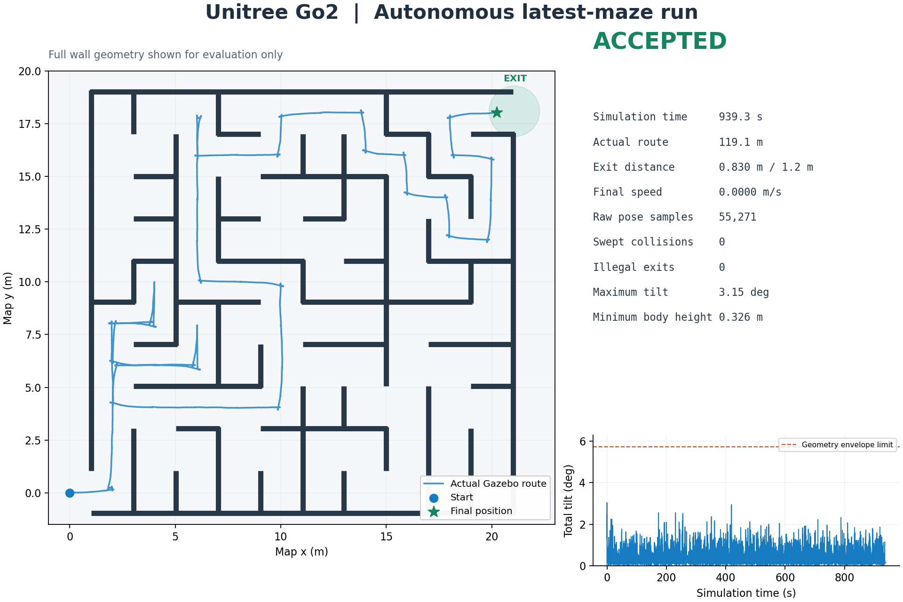

# ros2_gazebo_tugbot_navigate

ROS 2 / Gazebo 导航实验仓库，保留从 Tugbot 视觉巡航、Nav2 导航、在线探索到四足机器人自主走迷宫的阶段工作区。**当前推荐入口是 [Unitree Go2 工作区](ros2_ws_go2_maze_20261107/README.md)**。不同日期的工作区分别构建，分别加载环境。

## 当前成果：Go2 自主通关最新版迷宫

Go2 使用官方模型惯量、碰撞体和 12 个关节力矩 PID，通过足地接触运动。沿用 `ros2_ws_tugbot_nav_20260728` 的最新 2 倍尺寸迷宫与在线 flood-fill 导航，内部墙体边走边发现。

| 本轮验收 | 实测 |
| --- | ---: |
| 修正后完整自主运行 | 1 轮通过 |
| 仿真时间 / 实际累计路程 | 939.334 s / 119.122 m |
| 实际出口距离 / 项目允许半径 | 0.829765 m / 1.2 m |
| 最终线速度 | 0 m/s，持续停稳验收通过 |
| 原生位姿完整重放 | 55,271 条 |
| 几何碰撞 / 非法越界 | 0 / 0 |
| 最大总倾角 | 3.148° |
| Go2 核心回归 | 208 项通过 |

[验收报告与原始数据](docs/validation/2026-11-07-go2-maze/README.md) · [成功经验](docs/experience/2026-11-07-go2-maze-success.md) · [全部文档入口](docs/README.md)



“通关”采用项目的出口区域定义：真实位姿进入半径 1.2 m 的出口范围并停稳。这是单轮修正后实测结果，尚未做多种子可靠性统计。导航沿用 Gazebo 世界坐标里程计，实机腿式里程计与无真值 SLAM 适配属于后续工作。

## 快速复现

已验证环境：Ubuntu 26.04、ROS 2 Lyrical、Gazebo Jetty 10.5。本机使用 NVIDIA RTX 5090 Laptop；GPU 雷达和相机需要可用的渲染环境。历史 Jazzy / Harmonic 工作区的安装与启动命令见各自说明。

在新终端、仓库根目录执行：

```bash
cd ros2_ws_go2_maze_20261107
source /opt/ros/lyrical/setup.bash
colcon build --symlink-install --packages-select \
  go2_description tugbot_description tugbot_gazebo tugbot_maze go2_maze_bringup
./tools/test_go2_core.sh
./run_go2_maze.sh
```

最后一条命令打开 Gazebo + RViz 并自动起步。Ctrl+C 结束本次 launch。自动化验收入口为：

```bash
./tools/run_checked_maze.sh
```

它创建全新证据目录，等待真实出口与停稳验收，关闭本次仿真，再对完整真实轨迹重放；运行上限为 1800 仿真秒或 3600 墙钟秒。[参数和联调说明](ros2_ws_go2_maze_20261107/src/go2_maze_bringup/README.md) · [工具使用](ros2_ws_go2_maze_20261107/tools/README.md)

## 本轮可复用经验

1. **先检查真实入口与代码，再看历史 README。** 20260728 的实际 SDF 使用 Tugbot，正文仍有 ANYmal 阶段说明。换 Go2 时必须核对模型、运动学、控制器和 TF，不能只替换 mesh。
2. **先标定身体运动，再调整导航时限。** 官方关节力矩上限保留；P=320、D=4 的实测直行/转向响应优于初始参数。用真实位移、转角和停车结果调整超时。
3. **足迹必须覆盖后膝、小腿与迈步范围。** 采用 x=[-0.42,0.37]、|y|≤0.25 m 的保守矩形，并将总倾角限制在已抽样的检查域内。
4. **统一传感器与定位坐标约定。** 中置雷达、真实 sensor header、静态安装 TF、`map→odom→base_link` 和仿真时钟一并验证。
5. **离散出口格到达后继续精确收尾。** 首轮实际停在 1.223210 m，验收正确拒绝；增加低速收尾进入 0.85 m 内部目标区后，完整重跑通过。
6. **验收保留独立原始证据。** 完整墙图仅用于验收/绘图；新运行目录、新状态文件、原生位姿扫掠和退出清理共同防止误用旧 PASS。

数值、代码位置、反例和适用范围见 [经验总结](docs/experience/2026-11-07-go2-maze-success.md)。

## 工作区与阅读路线

| 工作区 | 用途 |
| --- | --- |
| [20261107 Go2](ros2_ws_go2_maze_20261107/README.md) | 当前四足自主迷宫入口，Lyrical / Jetty |
| [20260728](ros2_ws_tugbot_nav_20260728/README.md) | 本次集成的实际最新基础工作区 |
| [20260705](ros2_ws_tugbot_nav_20260705/README.md) | 在线发现内部墙体、增长参照图定位的历史里程碑 |
| [20260614](ros2_ws_tugbot_nav_20260614/README.md) | 已知完整墙图 scan-match + 自主路线发现 |
| [20260522](ros2_ws_tugbot_nav_20260522/README.md) | 预计算 BFS 走廊序列的 guided 迷宫基线 |
| [20260514](ros2_ws_tugbot_nav_20260514/README.md) | SLAM、frontier/perimeter 探索、Phase 14 地图与静态回放 |
| [20260513](ros2_ws_tugbot_nav_20260513/README.md) | 已知静态地图 AMCL + Nav2 |
| [20260419](ros2_ws_tugbot_20260419/README.md) | 相机蓝线检测、PID 与视觉巡航最小闭环 |

20260712～20260727 的其他历史迭代入口见 [文档索引](docs/README.md)。历史工作区正文和代码保留；其“当前”“最新”描述属于当时阶段，入口提示指向本轮 Go2。

## 当前源码结构

```text
ros2_ws_go2_maze_20261107/
├── setup.bash / run_go2_maze.sh
├── src/
│   ├── go2_description/      # 官方 Go2 URDF、DAE、来源与许可
│   ├── go2_maze_bringup/     # 当前 launch、bridge、RViz
│   ├── tugbot_description/   # 当前原生 Go2 SDF；兼有历史模型
│   ├── tugbot_gazebo/        # 最新迷宫与 Go2 平地验证场景
│   └── tugbot_maze/          # 在线导航、步态、出口收尾、独立验收
└── tools/                   # 核心检查、物理标定、验收与绘图
```

[包索引](ros2_ws_go2_maze_20261107/src/README.md)。`build/`、`install/`、`log/`、缓存属于本机生成物，Git 忽略；可复核证据单独归档在 `docs/validation/`。

## 验证边界

- 核心 208 项通过。广泛历史测试记录为 564 通过、7 失败；6 项是旧 wall-follow 用例，1 项要求原仓库缺失的 `maze_20260522.jpg`。缺少 `nav2_msgs` 的旧 reactive_pilot 测试未运行。[完整日志与解释](docs/validation/2026-11-07-go2-maze/README.md)。
- 零碰撞指指定步态/姿态范围内的保守几何检查，未测接触力；完整仿真验收不等于实机安全认证。
- 聚焦启动不启动 Nav2 或 slam_toolbox。不要同时加载其他日期工作区中同名包，或使用旧脚本全局杀进程、清理共享内存。

## 来源与致谢

Go2 来自 [Unitree 官方 unitree_ros](https://github.com/unitreerobotics/unitree_ros)，固定提交、原文件与 mesh 校验值见 [SOURCE.md](ros2_ws_go2_maze_20261107/src/go2_description/SOURCE.md)，许可为 [BSD-3-Clause](ros2_ws_go2_maze_20261107/src/go2_description/LICENSE)。历史模型与包保留各自来源和许可；原视觉巡航项目使用 [MIT](ros2_ws_tugbot_20260419/LICENSE)，此处不将所有第三方资源统一改为 MIT。

感谢 ROS 2、Gazebo、ros_gz、Nav2、slam_toolbox、Unitree Robotics，以及 UM FST 徐老师、bilibili 后来老师。
