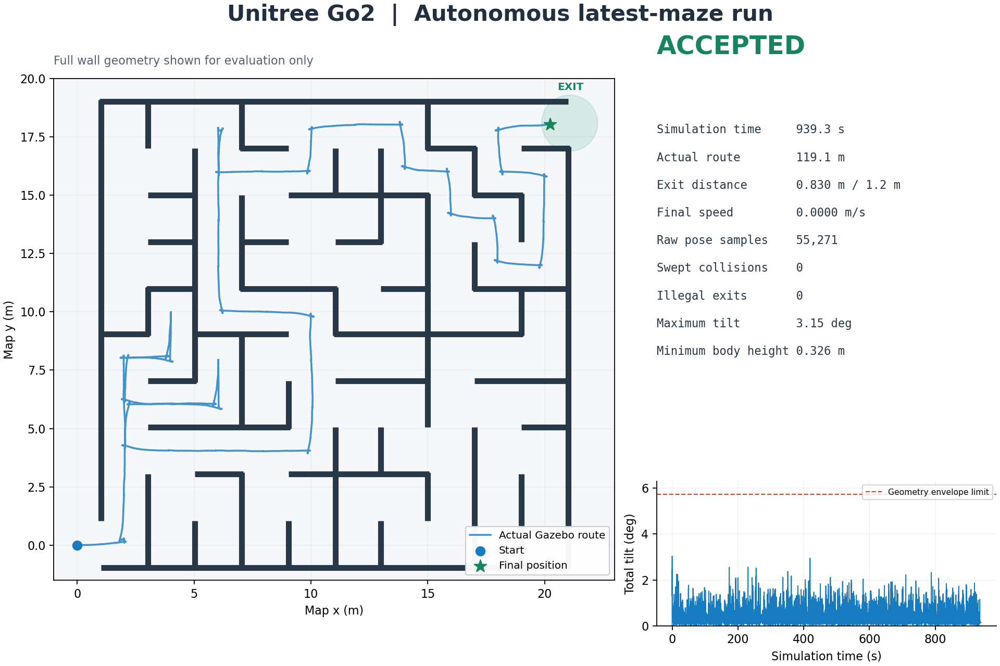

# Go2 最新迷宫实测：2026-11-07

正式工作区：`ros2_ws_go2_maze_20261107`。基础提交 `2381e500e369b7a33d6ca9968e3b7ce7d45f762f`，沿用 `ros2_ws_tugbot_nav_20260728` 的实际最新迷宫。

本轮 Go2 从入口自动起步，自主探测内部墙体、选择路线并到达出口，收步站立。控制由 12 个关节力矩 PID 和足地接触完成。无基座外力驱动、路线脚本或运行中传送。

| 项目 | 实测 |
|---|---:|
| 独立在线验收与完整轨迹重放 | 均通过 |
| 仿真时间 | 939.334 s |
| 原生位姿累计路程 | 119.122 m |
| 最终 map 位姿 | (20.244673, 18.027802, yaw 0.062962) |
| 实际出口距离 / 允许半径 | 0.829765 / 1.2 m |
| 最终线速度 | 0.000000 m/s |
| 原生位姿 / 扫掠检查样本 | 55271 / 55271 |
| 几何碰撞 / 非法越界 | 0 / 0 |
| 最大总倾角 | 3.148° |
| 最低机体高度 | 0.326499 m |
| 两条原生 GT / odom 输出最大比对差 | 0.009347 m |



## 证据与复核

- [原始位姿 CSV](accepted/ground_truth.csv)、[在线验收状态](accepted/status.json)、[完整重放结果](accepted/replay_audit.json)。CSV 样本数与最终状态完全一致。
- [压缩启动日志](accepted/launch.log.gz)、[监督器日志](accepted/watch.log)。日志包含 EXIT_CELL_REACHED → 低速收尾 → EXIT_REACHED。
- [Gazebo 出口站立画面](accepted/gazebo.png)、[RViz 在线三维地图](accepted/rviz.png)。
- [208 项核心回归](core-final.log)、[扩展历史测试](all-available-tests.log)、[官方碰撞体抽样](envelope-final.log)、[平地运动标定](flat-motion.log)。

```bash
cd ros2_ws_go2_maze_20261107
source setup.bash
python3 tools/replay_go2_audit.py ../docs/validation/2026-11-07-go2-maze/accepted --require-success
./tools/test_go2_core.sh
./run_go2_maze.sh
```

Go2 核心检查 208 项通过。广泛历史测试为 564 项通过、7 项失败；失败是原 README 已记录的 6 项旧 wall-follow 用例及 1 项缺失 maze_20260522.jpg 的资产用例。缺少 nav2_msgs 的旧 reactive_pilot 测试未运行。本次在线 flood-fill 启动不使用它，也不启动 Nav2 或 slam_toolbox。

## 验收修正

首次完整运行已到离散出口格，但实际停在距出口 1.223210 m 处，比 1.2 m 验收范围差约 2.3 cm，验收器正确拒绝成功，见 [首轮状态](first-run-stopped-short.json)。已加入仅使用在线导航位姿和新鲜雷达的低速收尾：进入 0.85 m 内部目标区并站立两秒后才发布出口事件，再由独立实际位姿验收停稳。

审查还修正了轮式/机身足迹遗漏 Go2 后膝的问题。保守矩形现为 x=[-0.42,0.37]、|y|≤0.25 m。几何抽样覆盖 81000 个步态配置、25 个机体姿态及全部 27 个官方碰撞体；验收总倾角限 0.1 rad，另留超过 2 cm 几何跟踪余量。扫掠检查步长不超过 1 cm / 0.02 rad。此为独立几何碰撞检查，不是接触力传感器报告。

一键验收脚本要求新证据目录和新状态文件，避免旧 PASS 误判。关闭期间重复中断不再跳过最终重放；该边界由专门回归覆盖。此次物理运行结束后因该关闭边界导致自动重放未执行，已单独执行严格重放并通过，输出已归档；运动控制与通关结果不受影响。

## 环境与适用范围

Ubuntu 26.04、ROS 2 Lyrical、Gazebo Jetty 10.5、NVIDIA RTX 5090 Laptop。保留原项目的世界坐标 Gazebo 里程计与已知入口/外围边界设计；内部墙体参考在线发现。完整墙图只用于独立验收和结果绘图。该结果验证仿真链路，不能直接等同于实机无真值腿式里程计 SLAM。

本次结论是修正后的这一轮完整运行通过，尚未做多种子可靠性批量统计。历史工作区的运行代码保留；后续仅补充历史入口提示。源代码与原始证据一并归档，发布位置以本轮分支和提交记录为准。

[本轮成功经验](../../experience/2026-11-07-go2-maze-success.md) · [验收记录索引](../README.md)
