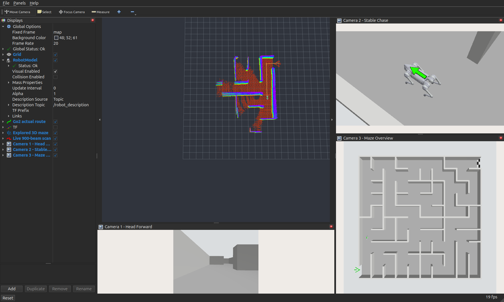

# Go2 三相机与绿色背部箭头：验证记录

最终配置包含头部前视、固定世界方向的斜上方跟随、迷宫中心俯视和绿色背部前向箭头。原生 Gazebo 图像在 RViz 三个独立窗格中同时显示；带这些最终设置的实例已完整通关并停稳，严格轨迹重放通过。

环境：Ubuntu 26.04、ROS 2 Lyrical、Gazebo Jetty 10.5；NVIDIA 渲染传感器、Mesa 渲染 RViz。基线为 PR #1 合并提交 `d51462542b04fceaa4a4dd78e87be55517013021`，本轮分支 `codex/go2-three-cameras-20261107`。[实现经验](../../experience/2026-11-07-go2-cameras-and-marker.md)

## 最终界面与配置



| 相机 | ROS 图像 | 分辨率 / 配置帧率 | 最终视角 |
| --- | --- | --- | --- |
| 1 | /camera/front/image | 720×540 / 20 Hz | 头部前向 |
| 2 | /camera/chase/image | 1280×720 / 20 Hz | Go2 世界位置加 (-1.2,-0.9,+3.5) m，固定世界方向 |
| 3 | /camera/overview/image | 1024×1024 / 10 Hz | 世界中心 (0,0,24 m) 向下，画面上方 +Y |

二号模型配置 `follow_yaw=false`：狗转弯时相机只平移，地平线和世界视线方向保持不变。背部箭头沿机体 +X 指向机头，随身体转动；绿色 32×15 cm、含深色边框 34×16.8 cm。新 mesh 为本地视觉资源，与官方七份 mesh 区分来源，不增加质量、关节或碰撞体。

三路共用仿真时钟，按各自帧率异步刷新；接收率取决于负载，下面表格中的 Hz 为仿真时间下的实际接收率。窗口可拖动、浮动和放大。头部近景看前方，二号看姿态，三号看位置；完整迷宫视角中的狗较小，绿色箭头提高辨识度。

## 最终设置下的完整通关

以下来自带箭头的同一自主实例成功后封存的 [accepted/status.json](accepted/status.json)，不包含随后停在出口的长时间空闲记录：

| 指标 | 实测 |
| --- | ---: |
| 成功封存时仿真时间 | 918.932 s |
| 累计实际路程 | 117.936 m |
| 实际出口距离 / 项目半径 | 0.709254 m / 1.2 m |
| 最终线速度 | 0 m/s |
| 原生位姿 / 扫掠样本 | 54,050 / 54,050 |
| 几何碰撞 / 非法越界 | 0 / 0 |
| 最大总倾角 / 最低身体高度 | 4.195° / 0.327981 m |
| 原生真值与 odom 最大平面差 | 0.009867 m |

[原始轨迹](accepted/ground_truth.csv)、[严格重放结果](accepted/replay_audit.json)、[监督日志](accepted/watch.log)、[出口处 RViz](accepted/ui/rviz.png) 一并保留。发布前在副本上再次执行 `replay_go2_audit.py --require-success`，`success=true`、`geometry_pass=true`、`dataset_complete=true`。

这是最终设置下的一轮实测，不是多种子可靠性统计。几何验收采用保守足迹与完整墙图，未测接触力；导航本身继续使用已知边界与在线发现内部墙体，沿用世界坐标里程计。

## 分阶段相机检查

| 记录 | 模式和时长 | 实际运动 | 结果 |
| --- | --- | --- | --- |
| [camera-check](camera-check/camera_check.json) | 初始随航向，90.236 s | 12.152 m、航向范围 3.784 rad | 三路持续成像；最大跟随误差 0.02240 m |
| [fixed-world-direction](fixed-world-direction/camera_check.json) | 切换固定方向后的站立，10.268 s | 已在出口站立 | 500 对 TF/odom，固定光轴检查通过 |
| [fixed-world-walk](fixed-world-walk/camera_check.json) | 固定方向，90.1 s | 11.867 m、航向范围 1.784 rad | 三路刷新；最大跟随误差 0.02096 m |
| [back-marker](back-marker/camera_check.json) | 固定方向加背部箭头，45.084 s | 5.873 m、航向范围 1.691 rad | 标记转弯前后可见；最大跟随误差 0.02096 m |

初始 90 秒记录接收前视/跟随/全景 1702/1566/784 帧，约 18.87/17.37/8.70 Hz；末帧年龄 0.044 仿真秒，三路时间戳跨度 P99 为 0.25 s。初始模式的数值不冒充最终固定方向模式，旧记录原样保留。

约 373.957 s 的早期 [audit-snapshot](audit-snapshot/replay_audit.json) 是 22,009 条位姿的短程几何检查，`success=false`；它与上面最终完整通关的 accepted 是不同阶段。之前工作区 Go2 集成的 939.334 s 通关记录仍在原目录中，未改写为新一轮试验。

## 发布检查与隔离

- 发布前六包构建成功，核心回归 218 项与原生几何 CTest 1/1 通过；结果分别见 [release-build.log](release-build.log)、[release-core.log](release-core.log)、[release-ctest.log](release-ctest.log)。
- 原生几何覆盖偏移、瞄准、固定方向、随航向备选、身体倾斜隔离及 yaw 绕回；Python 覆盖相机资源、全景墙角视场、桥接、窗格、生成位姿、停流与噪声误判等。
- [visual-isolation.json](visual-isolation.json) 确认新增标记 visual 以外，URDF 与原生 SDF 和基线规范化结果完全相同；两份箭头 mesh 字节相同。
- [disabled-camera-check.json](disabled-camera-check.json) 确认 observer_cameras=false 时原头部图像正常，无额外相机 spawner、桥接或图像 topic。
- [reload.log](reload.log) 确认可见窗口重载后相机窗格可见；布局使用 Hide Right Dock=false。
- TF 与图像完整窗口/末尾时效、区域均值后的噪声判据均有回归。补齐 TF 检查后，发布前在当前站立实例再观察 10.268 s / 515 对 TF，新鲜度和固定方向通过：[release-live](release-live/camera_check.json)。首次 smoke 的 vendor ros_gz_bridge 在退出时出现崩溃日志，运行中图像链路正常；本轮未更改 vendor 包。

未重跑整个历史测试集。原报告中的旧 wall-follow 六项与缺失旧图片一项失败，以及未安装 nav2_msgs 的旧 pilot 限制仍适用，不能声称历史全套测试全绿。

## 复现

先按 [工作区 README](../../../ros2_ws_go2_maze_20261107/README.md) 构建全部六包。以下从工作区根目录执行：

```bash
./run_go2_maze.sh
# 另一个同 domain/partition 的终端：
source setup.bash
python3 tools/check_go2_cameras.py /tmp/new-camera-check --seconds 90 --require-motion
./tools/test_go2_core.sh
ctest --test-dir build/go2_observer_cameras --output-on-failure
```

输出目录须为空。固定世界方向为默认；若手动把相机 SDF 改为 follow_yaw=true，检查器也要加 `--follow-yaw`。仅站立去掉 `--require-motion`。关闭额外观察相机用 `observer_cameras:=false`。

完整自动验收执行 `./tools/run_checked_maze.sh`。重放已归档数据时先复制到新目录，再运行 `python3 tools/replay_go2_audit.py <副本目录> --require-success`，避免改写版本化证据。
