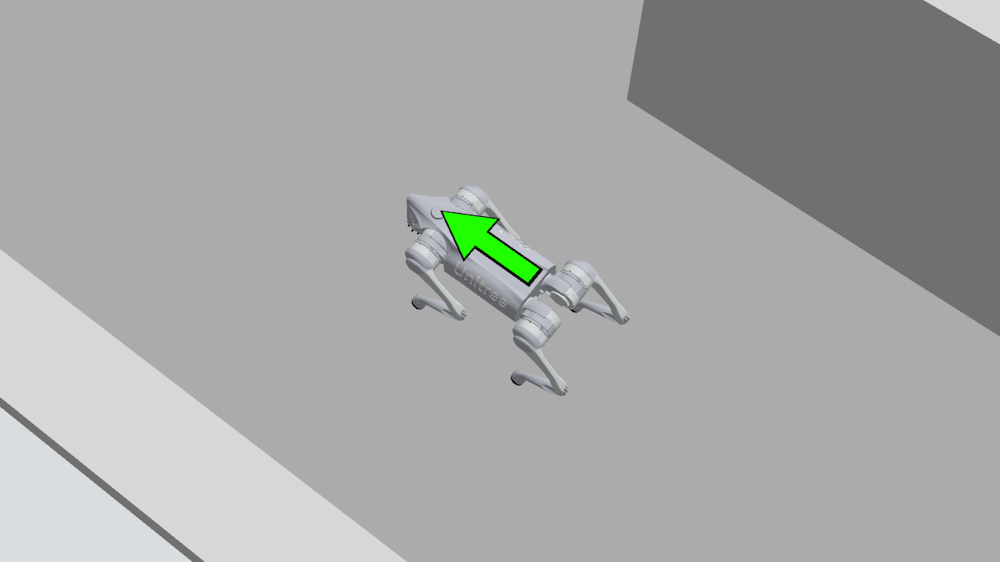

# Go2 背部亮绿色方向标记

按用户提出的识别需求，采用贴合背部的亮绿色大箭头，沿机体 +X 指向机头，带深色边框以提高灰色背景上的对比度。绿色部分 32×15 cm，含边框 34×16.8 cm；安装在 base_link 的 z=0.102 m 处。Gazebo 实体和 RViz RobotModel 使用同一份本地 Collada 资源。

[三号相机实际大全景](overview-end.png) · [RViz 三窗格](rviz.png) · [动态相机检查 JSON](camera_check.json)

验证前后 URDF / 原生 SDF：移除新增的唯一 visual 后，XML 规范化比较完全相同。因此未改动任何原有惯量、碰撞、关节、传感器或控制插件。原七个官方 mesh 保持原样，本地新增资源及来源说明单独记录。可用工作区工具 generate_go2_back_marker.py 重生成两处相同 mesh，generate_go2_model.py 会从 Xacro 保留该 visual。

四个资源/启动包构建成功；既有核心回归 217 项通过（core.log）。重新加载带标记的模型后，45.084 仿真秒走转检查通过：5.873 m、航向范围 1.691 rad，二号保持固定世界方向，最大跟随误差 0.02096 m。实际检查了转弯前后背部箭头、三号俯视中的绿色位置提示及 RViz 成像。此为视觉变更后的短程验证，不替代完整通关验收；本轮之后继续自主探索。

后续同一实例已完整通关并停稳，封存状态和严格重放见 [accepted](../accepted/status.json)；本目录保留的是45秒视觉/动态检查数据。
